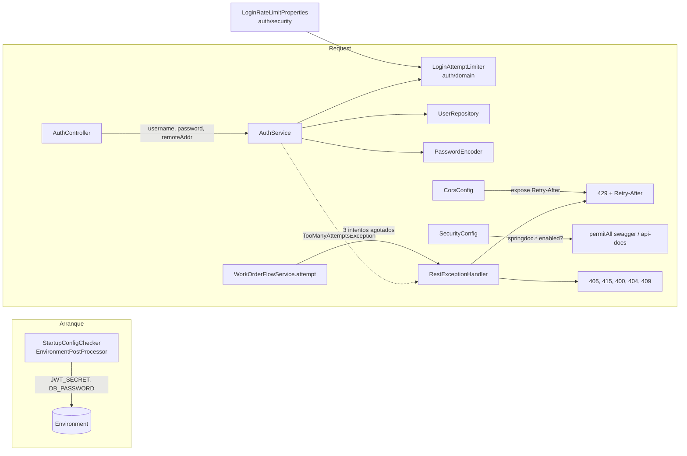
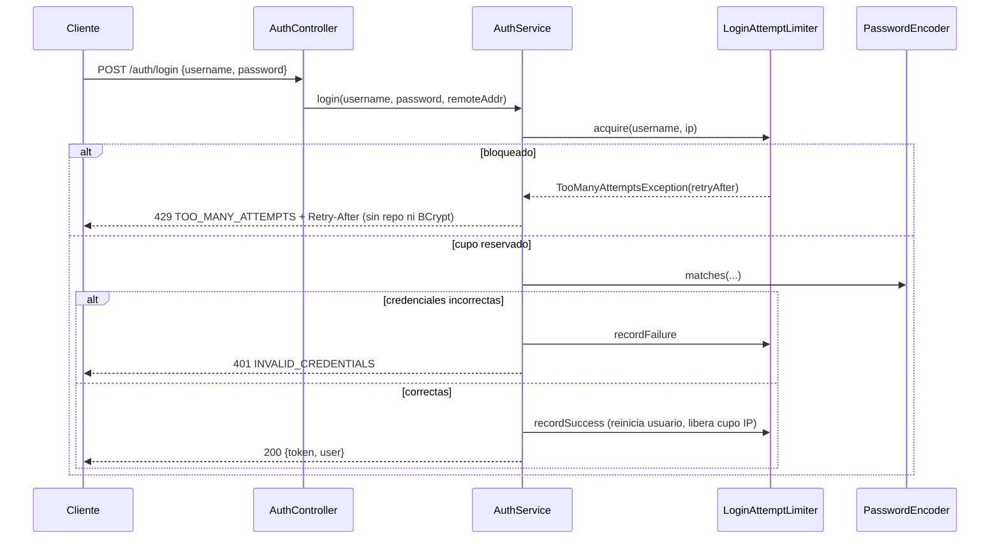

# Diseño: Spec 06 — Hardening de seguridad

Referencia: `requirements.md` de esta carpeta (REQ-1 a REQ-14, NFR-1 a NFR-3). Sin
migraciones. Rutas relativas a `src/main/java/com/enterpriselab/api/` (`J/`),
`src/main/resources/` (`R/`) y `src/test/` (`T/`).

## 1. Hallazgo que condiciona el diseño

`application.yml` define `secret: ${JWT_SECRET}` y `password: ${DB_PASSWORD:enterpriselab}`.
Al enlazar `@ConfigurationProperties` (y `DataSourceProperties`), Spring **no falla** ante un
placeholder sin resolver: deja el texto literal. Evidencia: los `*IT` sin perfil `dev`
(`ApiApplicationIT`, `HealthIT`, …) arrancan sin `JWT_SECRET` en el entorno. Hoy, sin la
variable, la API firmaría con la clave `${JWT_SECRET}` (13 bytes, conocida). El README
("sin él la aplicación no arranca") y la auditoría (punto 6) lo daban por cierto; era una
suposición no verificada.

Consecuencia: la validación **no puede apoyarse en el placeholder**. Se valida el valor
resuelto en un `EnvironmentPostProcessor`, antes de crear ningún bean (REQ-6, REQ-7).

## 2. Arquitectura



Capas, según `CLAUDE.md`: la política de bloqueo es lógica de `domain`; las propiedades y el
cableado de Spring viven en `security` (mismo patrón que `JwtConfig`/`CorsConfig`); la
traducción HTTP vive en `web`/`shared/web`.

## 3. Componentes

### 3.1 `LoginAttemptLimiter` (`J/auth/domain/`) — REQ-1, REQ-2, REQ-3.4, 3.5, 3.6, REQ-4

Clase de dominio sin anotaciones de Spring; se instancia desde `LoginRateLimitConfig` con
`(int maxPerUser, int maxPerIp, Duration window, Clock clock)`.

- Estado: `Map<String, Entry>` con dos espacios de claves (`u:<username normalizado>` y
  `i:<ip>`). `Entry(Instant windowStart, int reserved, int failures, Instant blockedUntil)`:
  `reserved` son los intentos que entraron y no terminaron (más los fallos de la ventana);
  `failures` solo los fallos reales.
- **Normalización del usuario** (REQ-1.4): `strip()` + `toLowerCase(Locale.ROOT)`.
- **API**
  - `void acquire(String username, String ip)`: consulta y reserva en una sola sección
    crítica. Una clave está bloqueada si `blockedUntil` es futuro o si `reserved >= max`. Si la
    IP o el usuario están bloqueados lanza `TooManyAttemptsException(retryAfter)` **sin
    modificar nada**; si no, suma 1 a `reserved` de ambas (creando la entrada con
    `windowStart = ahora` si no existía).
  - `void recordFailure(String username, String ip)`: `failures++` en ambas; si `failures >= max`
    y no hay `blockedUntil`, lo fija en `ahora + window` (una sola vez, no se extiende:
    REQ-3.5). Un login legítimo concurrente no adelanta el bloqueo, porque solo cuentan fallos.
  - `void recordSuccess(String username, String ip)`: borra la clave de usuario (REQ-1.3) y, en
    la de IP, `reserved--`; si `reserved` llega a 0 la entrada se elimina.
  - `void release(String username, String ip)`: `reserved--` en ambas (y elimina las que
    lleguen a 0); se usa si la verificación termina en una excepción inesperada (por ejemplo,
    la base caída), para no penalizar un error del servidor.
  - `int size()` y `purgeExpired()` (REQ-4.3); `reset()` para tests.
- **La ventana empieza en el primer fallo** (REQ de la sección Decisiones): una entrada existe
  solo mientras tiene fallos o intentos en vuelo, porque se elimina al quedar `reserved = 0`.
  Un login exitoso que no convive con fallos no deja rastro ni abre ventana. Una entrada vence
  en `blockedUntil` si existe, o en `windowStart + window`; al vencer se descarta y el
  contador vuelve a cero. Diferencia aceptada: `windowStart` se toma al reservar el primer
  intento que luego falla, no al registrar el fallo (milisegundos a segundos de BCrypt).
- **Por qué se reserva al entrar y no al fallar** (decisión técnica): contar solo los fallos
  deja pasar a todos los intentos simultáneos, que ven el contador en 0 mientras BCrypt tarda
  (REQ-4.4). Reservar acota los intentos en vuelo al umbral. Con umbral `N`: los intentos
  `1..N` pasan; si el `N`-ésimo falla fija el bloqueo; el `N+1` recibe `429`. Eso reproduce
  REQ-1.1 (5.º → `401`, 6.º → `429`).
- **Retry-After**: `max` de las esperas de las claves bloqueadas; si no hay `blockedUntil`
  (cupo agotado con intentos aún en vuelo) vale `windowStart + window − ahora`.
- **Concurrencia**: `synchronized` en los métodos públicos sobre un `HashMap`. La sección es
  de microsegundos, hay una sola instancia y es más fácil de razonar que `compute` anidados
  sobre dos claves con rollback. Alternativa descartada: `ConcurrentHashMap.compute` por
  clave (más complejo y sin ganancia a este volumen).
- **Memoria** (REQ-4.3): cada llamada purga como mucho una vez por minuto (`lastPurge`).
  Cota: una IP bloqueada ya no crea entradas de usuario (se rechaza antes de reservar),
  así que cada IP genera como máximo `maxPerIp` claves de usuario por ventana.
- Entradas inválidas: `username` o `ip` nulos se tratan como cadena vacía; en la práctica el
  `@Valid` del controlador ya rechazó el cuerpo (REQ-1.4b).

### 3.2 `TooManyAttemptsException` (`J/auth/domain/`) — REQ-3

`RuntimeException` con `Duration retryAfter()`. Mensaje fijo
`"Demasiados intentos fallidos. Probá de nuevo más tarde"` (REQ-3.1b).

### 3.3 `AuthService.login(username, password, clientIp)` — REQ-1, REQ-3.4

```
limiter.acquire(username, clientIp)                 // 429 antes de tocar repo o BCrypt
try {
  user = repo.findByUsername(username) ; ok = encoder.matches(password, hashOrDummy)
  if (user == null || !ok) { limiter.recordFailure(...); throw InvalidCredentials }
  limiter.recordSuccess(...); return AuthSession
} catch (InvalidCredentialsException e) { throw e }
  catch (RuntimeException e) { limiter.release(...); throw e }
```

`AuthController.login` pasa `request.getRemoteAddr()` (REQ-2.3). El `@Valid` corre antes, así
que un cuerpo inválido es `400` y no consume cupo (REQ-1.4b). `AuthService` recibe el
limiter por constructor; el dummy hash y el resto no cambian.

### 3.4 `LoginRateLimitProperties` y `LoginRateLimitConfig` (`J/auth/security/`) — REQ-4.1, 4.2

`@ConfigurationProperties("app.security.login-rate-limit")` como `record`
`(int maxAttemptsPerUser, int maxAttemptsPerIp, Duration window)` con `@DefaultValue`
(5, 20, 15m). El constructor compacto lanza `IllegalArgumentException` con el nombre de la
propiedad si algún valor es `<= 0` (mismo estilo que `CorsProperties`; el valor no es secreto).
`LoginRateLimitConfig` declara `@EnableConfigurationProperties(LoginRateLimitProperties.class)` (como
`CorsConfig`) y crea el bean del limiter con el `Clock` de `ClockConfig`. El error del constructor
compacto llega dentro del `BindException`, y su mensaje nombra la propiedad; un valor no
convertible (`abc`) lo nombra el propio binder. Ambos casos se prueban.

### 3.5 `RestExceptionHandler` (`J/shared/web/`) — REQ-3.1, 3.2, REQ-8 a REQ-12

Handlers nuevos, todos con `ApiError.of(...)`:

| Excepción | Estado | `code` | Detalle |
|---|---|---|---|
| `TooManyAttemptsException` | 429 | `TOO_MANY_ATTEMPTS` | cabecera `Retry-After` = `max(1, ceil(segundos))` |
| `HttpRequestMethodNotSupportedException` | 405 | `METHOD_NOT_ALLOWED` | cabecera `Allow` con los métodos admitidos |
| `HttpMediaTypeNotSupportedException` | 415 | `UNSUPPORTED_MEDIA_TYPE` | — |
| `MissingServletRequestParameterException` | 400 | `VALIDATION_ERROR` | `details: {parámetro: "Es obligatorio"}` |
| `MethodArgumentTypeMismatchException` | 400 | `VALIDATION_ERROR` | `details: {parámetro: "Valor inválido"}` |

`NoResourceFoundException` (404) y `Exception` (500) quedan como están (REQ-11, REQ-12): el
`Exception.class` sigue siendo el último recurso. Spring elige el handler más específico, por
lo que los nuevos ganan al genérico. `406` y el resto no se tocan (decisión aprobada).

### 3.6 `CorsConfig` — REQ-3.3

`configuration.setExposedHeaders(List.of("Retry-After"))`. Es lo que hace que el navegador del
frontend pueda leer la espera (la enmienda 19-A del frontend depende de esto).

### 3.7 `SecurityConfig` y `application.yml` — REQ-5

- `application.yml` base: `springdoc.api-docs.enabled: false` y
  `springdoc.swagger-ui.enabled: false`; el bloque `dev` los pone en `true`.
- `SecurityConfig` lee esas dos propiedades del `Environment` (única fuente de verdad, sin
  segunda lógica de perfiles) y solo agrega los `permitAll` de Swagger y `/v3/api-docs/**`
  cuando están en `true`. Sin `permitAll`, `anyRequest().authenticated()` da `401` sin token;
  con token, springdoc no registró los recursos y el `NoResourceFoundException` existente
  responde `404` con `ApiError` (REQ-5.1 y 5.1b). Con ambas en `false`, no existe el bean
  `OpenApiWebMvcResource` (REQ-5.3).
- `/actuator/health` sigue público.

### 3.8 `StartupConfigChecker` (`J/shared/config/`) — REQ-6, REQ-7, NFR-1

`EnvironmentPostProcessor` registrado en `R/META-INF/spring.factories`, con
`Ordered.LOWEST_PRECEDENCE` para correr después de la carga de `application.yml` y los
perfiles. Lee valores ya resueltos del `Environment` (sin pasar por el binder, que podría
volcar el valor en su mensaje):

- `app.jwt.secret`: vacío → `"JWT_SECRET no está definida"`; menos de 32 bytes UTF-8 →
  `"JWT_SECRET debe tener al menos 32 bytes (UTF-8); tiene N"`. Nunca incluye el valor.
- `spring.datasource.password`: vacío → `"DB_PASSWORD no está definida"`.

Lanza `IllegalStateException`. Como corre antes de crear beans, falla sin intentar conectar
a la base. `application.yml` pasa a `secret: ${JWT_SECRET:}` y, en el base,
`password: ${DB_PASSWORD:}`; el bloque `dev` fija `${DB_PASSWORD:enterpriselab}` (REQ-6.2) y
conserva el secreto por defecto (38 bytes) (REQ-7.4). `app.cors` no cambia.

### 3.9 `WorkOrderFlowService.attempt()` — REQ-13

Al agotar `MAX_ATTEMPTS`, en vez de `IllegalStateException`: `log.warn` con el id y
`throw new ConflictException("WORK_ORDER_CONCURRENT_UPDATE", "La orden " + id + " cambió
mientras se procesaba; intentá de nuevo", Map.of())`. El handler de `ConflictException` ya
produce el `409`. No se escribe nada: las transiciones son `UPDATE` condicionales que tocaron
0 filas (REQ-13.2).

### 3.10 OpenAPI y README — REQ-14

`@ApiResponse(responseCode = "429", …, headers = @Header(name = "Retry-After"))` en
`AuthController.login`. README: sección "Variables de producción" (`JWT_SECRET`,
`DB_PASSWORD`, `APP_CORS_ALLOWED_ORIGINS`), sección del rate limiting (en memoria, una
instancia, se reinicia, tres propiedades y defaults), Swagger solo con `dev` en la tabla de
endpoints, y se corrige la frase "sin él la aplicación no arranca" por la verdadera.

## 4. Flujo principal



## 5. Impacto en los tests existentes (NFR-3)

| Test / clase | Cambio |
|---|---|
| Todos los `*IT` que arrancan el contexto (con y sin `dev`) | Se agrega `T/resources/config/application.properties` (`classpath:/config/` se aplica sobre el `application.yml` principal sin reemplazarlo) que fija **`app.jwt.secret`, `spring.datasource.password` y los límites del login holgados (1000/1000)** — con esos nombres de propiedad y no con `JWT_SECRET`/`DB_PASSWORD`, para no confundirse con las variables reales. Los límites holgados evitan que los tests que fallan logins a propósito se bloqueen entre sí a través del contexto cacheado. Los tests de arranque (§6) saltan este archivo con `--spring.config.location=classpath:/application.yml`. |
| `StartupFailureIT` | Debe seguir fallando por conexión: hereda esa propiedad de prueba, así que el `EnvironmentPostProcessor` no corta antes. |
| `AuthServiceTest` | Constructor con el limiter; casos nuevos en la sección 6. |
| `OpenApiIT` y los `*IT` con `@ActiveProfiles("dev")` | Sin cambios de comportamiento; `dev` mantiene Swagger y el default de `DB_PASSWORD`. |
| `RestExceptionHandlerTest` + `TestExceptionsController` | Se agregan endpoints de prueba (`@RequestParam` obligatorio y tipado) y casos de 405/415/400. |

## 6. Estrategia de pruebas (por requisito)

| Requisito | Prueba |
|---|---|
| REQ-1.1, 1.1b, 1.2, 1.3, 1.4, 1.5 | `LoginAttemptLimiterTest` (reloj fijo mutable) + `LoginRateLimitIT` (MockMvc, límites 5/20) |
| REQ-1.4b | `LoginRateLimitIT`: 10 cuerpos vacíos → siguen `400`, el login válido pasa |
| REQ-2.1, 2.2, 2.4 | `LoginAttemptLimiterTest` + `LoginRateLimitIT` (`remoteAddr` variable en MockMvc) |
| REQ-2.3 | `LoginRateLimitRealHttpIT` (`RANDOM_PORT`, cliente HTTP real): `X-Forwarded-For` distinto en cada request no evita el bloqueo; más una aserción sobre el `Environment` real: `server.forward-headers-strategy` es `none`. (MockMvc no reproduce el filtro ni la válvula del contenedor, por eso no sirve para esto.) |
| REQ-3.1, 3.1b, 3.2 | `LoginRateLimitIT`: cuerpo, mismo `message` por usuario/IP, `Retry-After` entero igual al restante ±1 s |
| REQ-3.3 | `CorsIT`: `Access-Control-Expose-Headers` contiene `Retry-After` en un `429` con `Origin` permitido |
| REQ-3.4 | `AuthServiceTest`: bloqueado ⇒ `verifyNoInteractions(userRepository, passwordEncoder)` |
| REQ-3.5, 3.6 | `LoginAttemptLimiterTest` (intentos bloqueados no cambian el bloqueo) + `LoginRateLimitIT` (`GET /auth/me` sigue respondiendo) |
| REQ-4.1, 4.1b, 4.2 | `LoginRateLimitPropertiesTest` + `LoginRateLimitIT` con propiedades propias |
| REQ-4.3 | `LoginAttemptLimiterTest`: tras vencer todo, `purgeExpired()` deja `size() == 0` |
| REQ-4.4 | `LoginAttemptLimiterTest`: 50 hilos con umbral 5 ⇒ exactamente 5 pasan |
| REQ-5.1, 5.1b, 5.3 | `OpenApiDisabledIT` (sin `dev`): 401 sin token, 404 con token, ausencia del bean |
| REQ-5.2 | `OpenApiIT` existente (`dev`) |
| REQ-6.1, 6.3, REQ-7.1, 7.2, 7.3, 7.5, NFR-1 | `StartupConfigCheckerTest` (sin contexto: `ConfigurableEnvironment` + `MockPropertySource`): vacío, 16 bytes, 32 bytes, que el mensaje nombre la variable y no contenga el valor |
| REQ-6.2, REQ-7.4 y el `application.yml` real | `StartupConfigIT`: `SpringApplication` sin web, `--spring.config.location=classpath:/application.yml` (sin el archivo de pruebas) y datasource a un puerto cerrado como en `StartupFailureIT`. Con `--spring.profiles.active=dev` y sin variables, el *checker* no falla (el arranque termina por conexión: se afirma que ninguna causa nombra `JWT_SECRET` ni `DB_PASSWORD`). Sin `dev`: `--JWT_SECRET=` vacío falla nombrándola; con `--JWT_SECRET` de 32 bytes y sin `DB_PASSWORD` falla nombrando `DB_PASSWORD`; con ambas, un `ApplicationEnvironmentPreparedEvent` captura que `spring.datasource.password` es el valor dado (REQ-6.3). |
| REQ-10.1, 10.2, 12 | `RestExceptionHandlerTest` (MockMvc standalone con `TestExceptionsController`): ningún endpoint real tiene un parámetro obligatorio o tipado (`page` y `size` son `String` validados en `domain`), así que se prueban con endpoints de prueba |
| REQ-8, 9, 10.3, 11 | `WebErrorsIT` (perfil `dev`, token de `admin`): `DELETE /work-orders`, `POST /work-orders` y `POST /auth/login` con `text/plain`, `GET /work-orders?page=abc`, `GET /no-existe` con y sin token |
| REQ-13 | `WorkOrderFlowServiceTest`: repo que devuelve `Optional.empty()` 3 veces ⇒ `ConflictException` con el código, sin `IllegalStateException`; `ListAppender` para el `warn`; `WorkOrderFlowControllerIT` si el diseño del test lo permite |
| REQ-14.1 a 14.4 | `OpenApiIT` (presencia del `429` con cabecera) + verificación manual de README con `grep` en la tarea de cierre |
| NFR-2 | Revisión del diff: ni `db/migration` ni `build.gradle.kts` cambian |
| NFR-3 | `./gradlew test` completo |

## 7. Riesgos y decisiones de despliegue

1. **Orden de despliegue**: la API arranca solo con `JWT_SECRET` (≥ 32 bytes) y `DB_PASSWORD`
   definidas. Si en el servicio de producción faltan o son cortas, **la API no levanta**. Hay
   que confirmarlo en F0 antes de desplegar (y, a diferencia de lo que se creía, hoy producción
   podría estar firmando con la clave literal `${JWT_SECRET}`: rotar los tokens al corregirlo).
2. **IP detrás del proxy** (decisión aprobada): sin propiedad de proxies confiables, todos los
   usuarios comparten el contador de IP en producción. Mitigación: enmienda 06-A tras F0.
   Mientras tanto se puede subir `max-attempts-per-ip` por variable de entorno sin recompilar.
3. **Bloqueo por usuario como denegación** (aceptado): 5 fallos bloquean la cuenta 15 min.
4. **Estado en memoria**: se pierde al reiniciar y no se comparte entre instancias.
5. **`forward-headers-strategy`**: Boot lo activa solo en algunas plataformas (Kubernetes,
   Cloud Foundry). Se fija `server.forward-headers-strategy: none` en `application.yml` para
   que REQ-2.3 no dependa del entorno.
6. **Swagger por propiedad, no por perfil** (riesgo aceptado): una variable `SPRINGDOC_SWAGGER_UI_ENABLED=true` en el servicio de producción reabriría el contrato aunque `dev` no esté activo. Es una decisión explícita del operador; se documenta en el README.

## 8. Alternativas descartadas

- **Filtro de servlet antes de la cadena de seguridad**: obligaría a leer el cuerpo para
  conocer el `username` (envoltorio de request cacheado). Hacerlo en `AuthService` usa el
  cuerpo ya validado y deja la regla en `domain`.
- **Bucket4j / Resilience4j**: sumaría una dependencia (NFR-2) para un contador simple.
- **Validar con `@Validated` en `JwtProperties`**: el binder puede imprimir el valor del
  secreto al fallar; el `EnvironmentPostProcessor` no.
- **Perfil `prod` explícito**: no existe hoy; "producción" es la ausencia de `dev`. Condicionar
  por propiedad (`springdoc.*`) evita introducirlo.

## 9. Trazabilidad

| Requisito | Cubierto por |
|---|---|
| REQ-1 | §3.1, §3.3 |
| REQ-2 | §3.1, §3.3, §7.5 |
| REQ-3 | §3.1, §3.2, §3.3, §3.5, §3.6 |
| REQ-4 | §3.1, §3.4 |
| REQ-5 | §3.7 |
| REQ-6, REQ-7, NFR-1 | §3.8 |
| REQ-8 a REQ-12 | §3.5 |
| REQ-13 | §3.9 |
| REQ-14 | §3.10 |
| NFR-2 | §8 (sin dependencias ni migraciones) |
| NFR-3 | §5 |

Decisiones técnicas sin requisito propio (justificadas arriba): contar al entrar (§3.1),
`synchronized` (§3.1), `EnvironmentPostProcessor` (§3.8), `forward-headers-strategy: none` (§7.5),
`release` ante errores inesperados (§3.1, §3.3).

---
**Estado:** Aprobado el 2026-10-22
